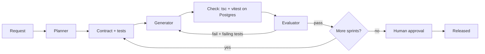

# ai-assisted-sdlc

A small, tested TypeScript harness that runs AI-assisted software delivery as a long-running multi-agent loop:
**Planner -> Contract -> Generator -> Check -> Evaluator -> Human gate**, plus a complete example that builds a
Node.js + Express + PostgreSQL room-booking API end to end, entirely in Docker.

Based on Anthropic's
[Harness design for long-running application development](https://www.anthropic.com/engineering/harness-design-long-running-apps).

## Run it (Docker only)

```bash
# Full scripted SDLC run: plans 6 sprints, builds them against a real Postgres, ~1 minute.
docker compose up --build --abort-on-container-exit --exit-code-from demo

# Harness unit tests (typecheck + vitest), no database needed.
docker compose --profile test run --rm unit

# Same flow with a real model instead of the recorded script (needs a key in .env).
cp .env.example .env   # then set ANTHROPIC_API_KEY=...
docker compose --profile live run --rm live
```

Without Docker (needs Node 22 and a Postgres at `DATABASE_URL`): `npm ci && npm ci --prefix examples/room-booking && npm run demo`.

## Live run with a real model

The scripted run replays recorded model turns, so it is free and deterministic. The live run sends the same flow to
the Anthropic Messages API: the model writes the plan, the contract tests, the code and the evaluations itself.

```bash
cp .env.example .env                       # set ANTHROPIC_API_KEY (and optionally ANTHROPIC_MODEL)

# 1. Smoke run: plan, then build only the first 2 sprints (a few minutes, a handful of calls).
docker compose --profile live run --rm live npm run demo:live -- --max-features 2

# 2. Full run. Ends at "AWAITING_APPROVAL": the human gate.
docker compose --profile live run --rm live

# 3. Review, then release. --resume reuses .harness/progress.json: no replanning, no rebuilding.
docker compose --profile live run --rm live npm run demo:live -- --resume --approve
```

What to look at afterwards (the workspace is mounted, so it stays on the host):

| Path under `examples/room-booking/workspace/` | Shows |
|---|---|
| `.harness/calls/NNN-<role>.json` | Every model call in order: system prompt, exact input, raw reply, latency |
| `.harness/spec.json`, `.harness/contracts/*.json` | Planner output and each sprint's contract (done, check, tests) |
| `.harness/progress.json` | Sprint state; what `--resume` continues from |
| `git log -p` | One commit per generator attempt, including the failed ones |

Each agent call starts from a fresh context. The contract and generator get the current workspace files (the
generator sees the contract tests from attempt 1). On a retry, the generator also gets the failing test names and
the check output. A live run is not reproducible. A sprint that fails 3 attempts ends with `BLOCKED` and exit
code 1; read its transcripts to see why. Use `--model <id>` to try another model.

## What you will see

Six sprints run in order. Two are built wrongly on the first attempt and repaired:

| Sprint | Attempt 1 | Outcome |
|---|---|---|
| 1-4 foundation, users/auth, rooms, bookings | correct | pass |
| 5 concurrency | transaction without a lock; **evaluator says 9/10** | **check fails** (10 of 20 requests win), retry adds a Postgres exclusion constraint, pass |
| 6 availability | `/rooms/:id` registered before `/rooms/available` | 400s, retry reorders the routes, pass |

## Principles

- Builder and judge are separate agents; **a deterministic check outranks the LLM judge**.
- Acceptance tests belong to the contract. The harness restores them before every check, so the generator cannot weaken them.
- No shared context window. State lives in `.harness/` (spec, contracts, progress) and git, so a crashed run resumes.
- A sprint that exhausts its retries blocks the run and escalates instead of building on a broken base.
- Human approval is required to release (`--approve` supplies it in the demo).

## Architecture

All diagrams (Mermaid): **[docs/architecture.md](docs/architecture.md)**; a real run is recorded in [docs/run-log.md](docs/run-log.md). Includes the Docker topology and the sprint-5 sequence.



## Layout

| Path | Role |
|---|---|
| `harness/src/harness.ts` | Orchestrator: roles, check gate, test protection, resume |
| `harness/src/llm.ts` | Anthropic client (fetch, no SDK) and `ScriptedLLM` |
| `harness/src/cli.ts` | `tsx harness/src/cli.ts <example> [--approve] [--resume] [--llm anthropic]` |
| `harness/test/` | Retry, check-beats-judge, block, approve, tamper-restore, path-escape, resume |
| `examples/room-booking/script/` | Recorded planner, contract tests, and generator attempts per sprint |
| `examples/room-booking/seed/` | Workspace scaffold (tsconfig, vitest config, scripts) |
| `Dockerfile`, `docker-compose.yml` | App image and the `db` / `demo` / `unit` / `live` services |

The generated project appears in `examples/room-booking/workspace/` (git-ignored, with its own git history,
one commit per attempt).

## Status

v0.2. Next: Playwright evaluator for UI work, few-shot calibration of the evaluator, per-phase cost and time
tracking, ablation switches (see section 8 of the architecture doc).
