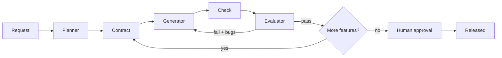

# ai-assisted-sdlc

A small, tested harness for running AI-assisted software delivery as a long-running,
multi-agent loop: **Planner -> Contract -> Generator -> Check -> Evaluator -> Human gate.**

Based on Anthropic's
[Harness design for long-running application development](https://www.anthropic.com/engineering/harness-design-long-running-apps).

- Builder and judge are separate agents; a deterministic check outranks the LLM judge.
- No shared context window. State lives in `spec.json`, `contract.json`, `progress.json` and git.
- Crash-safe: re-running resumes from `progress.json`.
- Human approval is required before release; a sprint that exhausts retries blocks and escalates.

**Full architecture and flow diagrams (Mermaid): [docs/architecture.md](docs/architecture.md)**



## Use

```bash
pip install -e ".[dev]" && pytest          # offline, scripted LLM
pip install -e ".[anthropic]"              # real model
```

```python
from sdlc import Harness, Config, AnthropicLLM

h = Harness(AnthropicLLM(), Config(), approve=lambda p: input("release? ") == "y")
print(h.run("A CLI todo app with add, list, done"))
```

## Layout

| Path | Role |
|---|---|
| `src/sdlc/harness.py` | Orchestrator, roles, gate, resume |
| `src/sdlc/llm.py` | `AnthropicLLM` and `ScriptedLLM` (tests) |
| `tests/` | Retry, gate-beats-judge, block, approve, resume |
| `docs/architecture.md` | All diagrams |

## Status

v0.1 skeleton. Next: Playwright/API evaluators, per-criterion few-shot calibration,
cost/time tracking per phase, ablation switches (see section 8 of the architecture doc).
