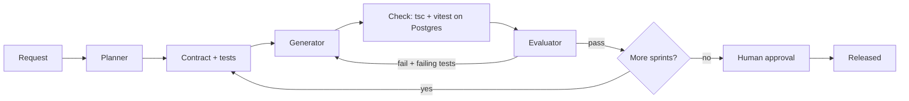

# ai-assisted-sdlc

A small, tested TypeScript harness that runs AI-assisted software delivery as a long-running multi-agent loop:
**Planner -> Contract -> Generator -> Check -> Evaluator -> Human gate**, plus a complete example that builds a
Node.js + Express + PostgreSQL room-booking API end to end, entirely in Docker.

Based on Anthropic's
[Harness design for long-running application development](https://www.anthropic.com/engineering/harness-design-long-running-apps).
The agent-first knowledge base (AGENTS.md as a map, `docs/` as the system of record, mechanical doc checks,
continuous "garbage collection" of tech debt) follows OpenAI's
[Harness engineering: leveraging Codex in an agent-first world](https://openai.com/index/harness-engineering/).

## Run it (Docker only)

```bash
# Full scripted SDLC run: plans 6 sprints, builds them against a real Postgres, ~1 minute.
docker compose up --build --abort-on-container-exit --exit-code-from demo

# Harness unit tests (typecheck + vitest), no database needed.
docker compose --profile test run --rm unit

# Same flow with a real model instead of the recorded script (needs a key in .env).
cp .env.example .env   # then set ANTHROPIC_API_KEY=...
docker compose --profile live run --rm live
```

Without Docker (needs Node 22 and a Postgres at `DATABASE_URL`): `npm ci && npm ci --prefix examples/room-booking && npm run demo`.

In Claude Code, `/sdlc [test|demo|live|resume|inspect]` runs any of these and summarises the result
([.claude/skills/sdlc/SKILL.md](.claude/skills/sdlc/SKILL.md)). Without Docker, it starts a local Postgres for you.

## Compare models and vendors (benchmark)

Same work, different LLMs, scored only by executing hidden tests. Any vendor with an Anthropic or OpenAI-compatible
API works (OpenAI, Google Gemini, Mistral, DeepSeek, OpenRouter, Ollama/vLLM); models are entries in
[benchmarks/models.json](benchmarks/models.json), keys come from `.env`, a model without a key is skipped.

```bash
# Offline sanity run: reference must score 100%, empty 0% (also runs in CI).
docker compose --profile bench run --rm bench

# codegen: 12 HumanEval-style tasks, pass@1 with 95% CI, latency, tokens, cost. Cents per model.
docker compose --profile bench run --rm bench npm run bench -- --suite codegen \
  --models reference,empty,claude-sonnet-5-5,openai-gpt,google-gemini
#   pass@k: add --samples 5 --k 1,5   (temperature 0.8, HumanEval convention)

# sdlc: the 6-sprint room-booking build with fixed contracts; only the generator role is the model under test.
docker compose --profile bench run --rm bench npm run bench -- --suite sdlc --models reference,claude-sonnet-5-5
```

Reports land in `benchmarks/results/<suite>-<timestamp>/` (`report.md`, `summary.json`, raw `results.jsonl`, and for
sdlc every transcript); `--publish` copies the leaderboard to `docs/generated/`. Methodology and fairness rules:
[docs/design-docs/benchmark-methodology.md](docs/design-docs/benchmark-methodology.md).

## Knowledge base for agents

[AGENTS.md](AGENTS.md) is the short map every coding agent reads first (Claude Code loads it through `CLAUDE.md`);
[ARCHITECTURE.md](ARCHITECTURE.md) maps the layers; `docs/` is the system of record: design docs, product specs,
execution plans, tech-debt tracker, generated schema, condensed library references and the quality, reliability
and security bars. `npm run docs:check` (also part of `npm test`) fails on broken links, unindexed docs, plans whose
status disagrees with their folder, and stale generated files.

## Live run with a real model

The scripted run replays recorded model turns, so it is free and deterministic. The live run sends the same flow to
the Anthropic Messages API: the model writes the plan, the contract tests, the code and the evaluations itself.

```bash
cp .env.example .env                       # set ANTHROPIC_API_KEY (and optionally ANTHROPIC_MODEL)

# 1. Smoke run: plan, then build only the first 2 sprints (a few minutes, a handful of calls).
docker compose --profile live run --rm live npm run demo:live -- --max-features 2

# 2. Full run. Ends at "AWAITING_APPROVAL": the human gate.
docker compose --profile live run --rm live

# 3. Review, then release. --resume reuses .harness/progress.json: no replanning, no rebuilding.
docker compose --profile live run --rm live npm run demo:live -- --resume --approve
```

What to look at afterwards (the workspace is mounted, so it stays on the host):

| Path under `examples/room-booking/workspace/` | Shows |
|---|---|
| `.harness/calls/NNN-<role>.json` | Every model call in order: system prompt, exact input, raw reply, latency |
| `.harness/spec.json`, `.harness/contracts/*.json` | Planner output and each sprint's contract (done, check, tests) |
| `.harness/progress.json` | Sprint state; what `--resume` continues from |
| `git log -p` | One commit per generator attempt, including the failed ones |

Each agent call starts from a fresh context. The contract and generator get the current workspace files (the
generator sees the contract tests from attempt 1). On a retry, the generator also gets the failing test names and
the check output. A live run is not reproducible. A sprint that fails 3 attempts ends with `BLOCKED` and exit
code 1; read its transcripts to see why. Use `--model <id>` to try another model.

## What you will see

Six sprints run in order. Two are built wrongly on the first attempt and repaired:

| Sprint | Attempt 1 | Outcome |
|---|---|---|
| 1-4 foundation, users/auth, rooms, bookings | correct | pass |
| 5 concurrency | transaction without a lock; **evaluator says 9/10** | **check fails** (10 of 20 requests win), retry adds a Postgres exclusion constraint, pass |
| 6 availability | `/rooms/:id` registered before `/rooms/available` | 400s, retry reorders the routes, pass |

## Principles

- Builder and judge are separate agents; **a deterministic check outranks the LLM judge**.
- Architecture is enforced, not reviewed: architect-owned rules (`examples/<name>/architecture.json`: layering, dependency
  direction, approved packages) run with every check, live outside the workspace, and violations go back to the generator.
- Acceptance tests belong to the contract. The harness restores them before every check, so the generator cannot weaken them.
- No shared context window. State lives in `.harness/` (spec, contracts, progress) and git, so a crashed run resumes.
- A sprint that exhausts its retries blocks the run and escalates instead of building on a broken base.
- The evaluator tests the running app, not just the diff: after a passing check the harness starts the app and runs
  the evaluator's own Playwright tests against it (`PROBE PASS/FAIL`). Probes inform the score; they are not a gate.
- The judge is calibrated against humans: `examples/<name>/calibration.json` holds real evaluator inputs with human
  grades. They are few-shot examples in every evaluator prompt, and `npm run calibrate` measures agreement and
  false approvals (scripted run: it catches the lenient 9/10 on sprint 5, exit 1).
- Human approval is required to release (`--approve` supplies it in the demo).

## Architecture

All diagrams (Mermaid): **[docs/architecture.md](docs/architecture.md)**; a real run is recorded in [docs/run-log.md](docs/run-log.md). Includes the Docker topology and the sprint-5 sequence.



## Layout

| Path | Role |
|---|---|
| `harness/src/harness.ts` | Orchestrator: roles, check gate, test protection, resume |
| `harness/src/architecture.ts` | Architecture-rules check (import graph vs. `architecture.json`) |
| `harness/src/probe.ts` | Starts the built app and runs the evaluator's Playwright probes against it |
| `harness/src/calibration.ts`, `calibrate.ts` | Few-shot calibration of the evaluator and the agreement report (`npm run calibrate`) |
| `harness/src/llm.ts` | Anthropic and OpenAI-compatible clients (fetch, no SDK, token usage) and `ScriptedLLM` |
| `harness/src/bench/` | Benchmark: model registry, codegen suite (sandboxed execution), pass@k / Wilson stats, reports, CLI |
| `harness/src/docs.ts` | Knowledge-base lint and generated docs (`npm run docs:check`, `npm run docs:gen`) |
| `benchmarks/` | `models.json` (vendors and models), `codegen/tasks.jsonl` (+ `build-tasks.mjs`), `results/` (git-ignored) |
| `AGENTS.md`, `ARCHITECTURE.md`, `docs/` | Agent-first knowledge base (see above) |
| `harness/src/cli.ts` | `tsx harness/src/cli.ts <example> [--approve] [--resume] [--llm anthropic\|<model id>] [--live-roles ...]` |
| `harness/test/` | Retry, check-beats-judge, block, approve, tamper-restore, path-escape, resume |
| `examples/room-booking/architecture.json` | The architect's rules for the example: independent routes, no upward imports, pool injected from `server.ts`, approved packages |
| `examples/room-booking/calibration.json` | Five human-graded evaluator cases from a real run (two are failures) |
| `examples/room-booking/script/` | Recorded planner, contract tests, generator attempts and evaluator probes per sprint |
| `examples/room-booking/seed/` | Workspace scaffold (tsconfig, vitest config, scripts) |
| `Dockerfile`, `docker-compose.yml` | App image and the `db` / `demo` / `unit` / `live` services |

The generated project appears in `examples/room-booking/workspace/` (git-ignored, with its own git history,
one commit per attempt).

## Status

v0.4: multi-vendor benchmark and agent knowledge base. Next: [docs/exec-plans/active/](docs/exec-plans/active/003-benchmark-v2.md)
(bootstrap CIs, more tasks, scheduled regression runs) and the [tech-debt tracker](docs/exec-plans/tech-debt-tracker.md).
