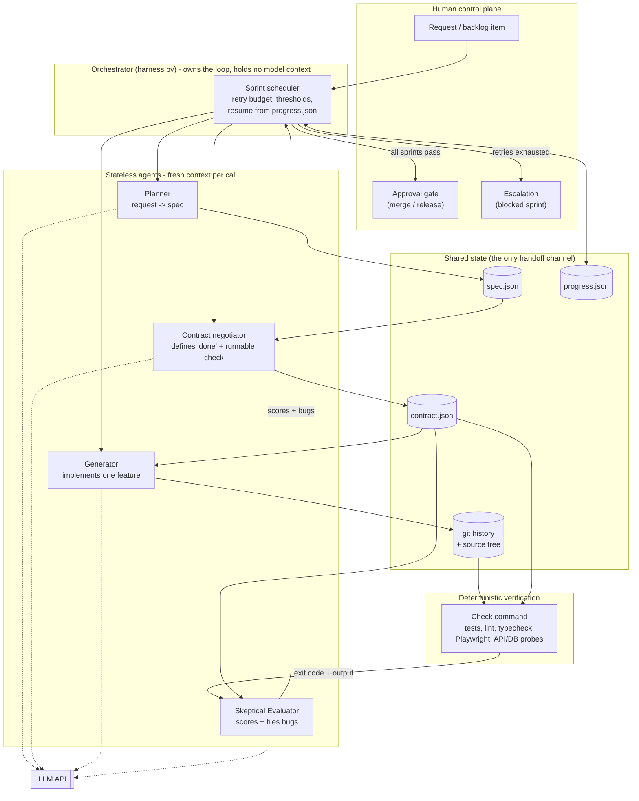
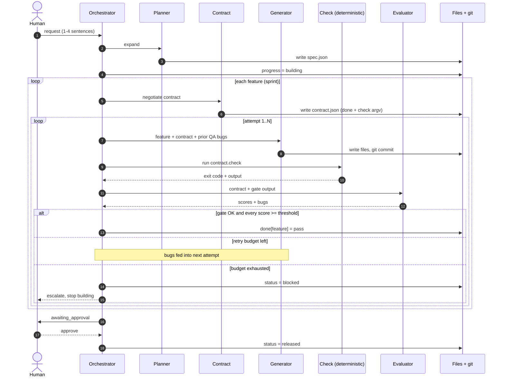
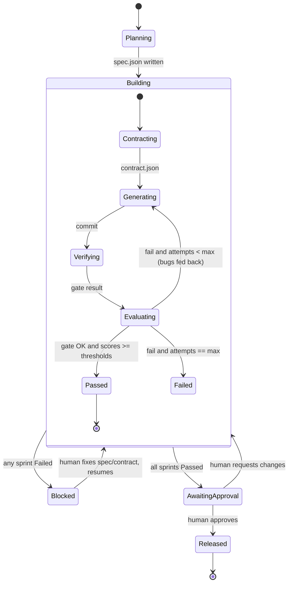
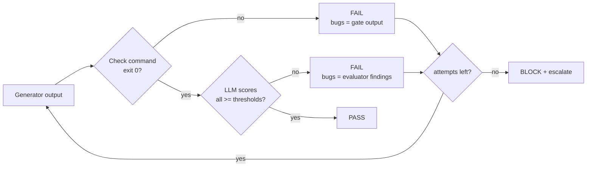
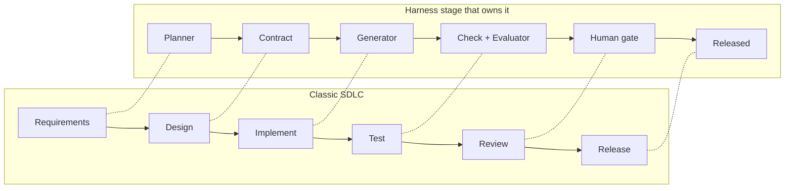
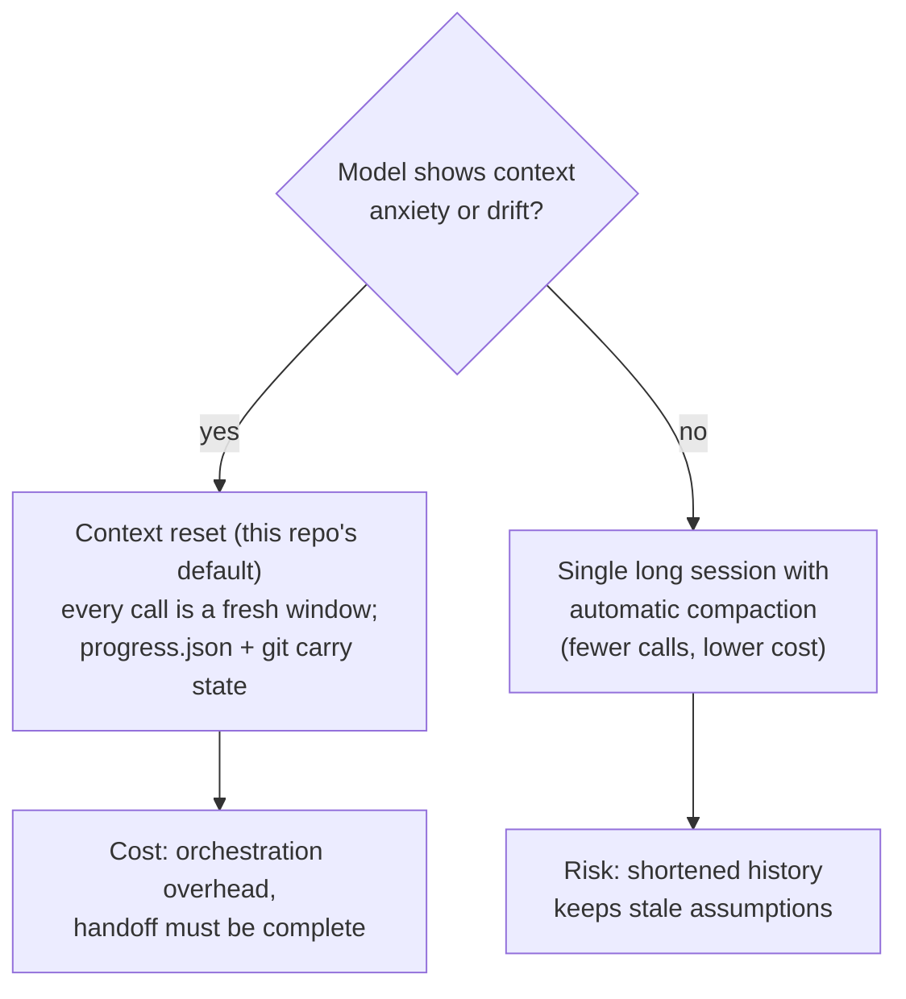

# Architecture

Design basis: Anthropic's [Harness design for long-running application development](https://www.anthropic.com/engineering/harness-design-long-running-apps).
Core idea: **the agent that builds is never the agent that judges**, agents share no context window,
and all state moves through files and git.

## 1. System architecture

## 2. End-to-end flow (sequence)

## 3. Sprint state machine

## 4. Pass/fail decision

The deterministic gate comes first and **cannot be overridden by the evaluator**: a 10/10 from the
LLM does not pass failing code (`test_gate_overrides_a_lenient_evaluator`).

## 5. Where this sits in the SDLC

## 6. Context strategy

## 7. Handoff artifacts

| File | Writer | Reader | Purpose |
|---|---|---|---|
| `spec.json` | Planner | Contract, Orchestrator | Ambitious scope, no implementation detail |
| `contract.json` | Contract negotiator | Generator, Check, Evaluator | Definition of done + runnable `check` argv |
| source tree + git | Generator | Check, Evaluator | Work product and rollback points |
| `progress.json` | Orchestrator | Orchestrator (next process) | Resume after crash or context reset |

## 8. Design assumptions to re-test as models improve

Each component encodes a belief that the model can't do something alone. Ablate one at a time.

| Component | Assumption | Test by |
|---|---|---|
| Planner | Model under-scopes from a short prompt | Skip it, compare feature count |
| Sprint contract | Model drifts from spec mid-build | Merge contract into generator prompt |
| Separate evaluator | Self-grading is lenient | Let generator self-score, compare escaped bugs |
| Per-sprint evaluation | Long builds need frequent QA | Evaluate once at the end |
| Context resets | Model gets anxious near the limit | Use compaction, compare completion |
