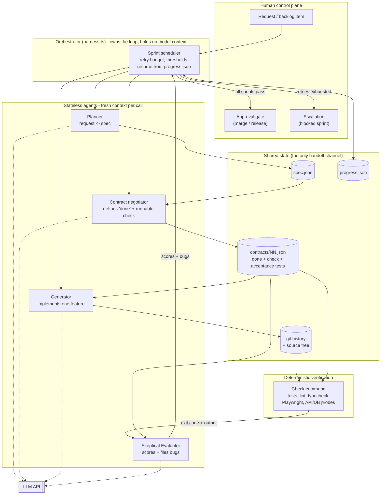
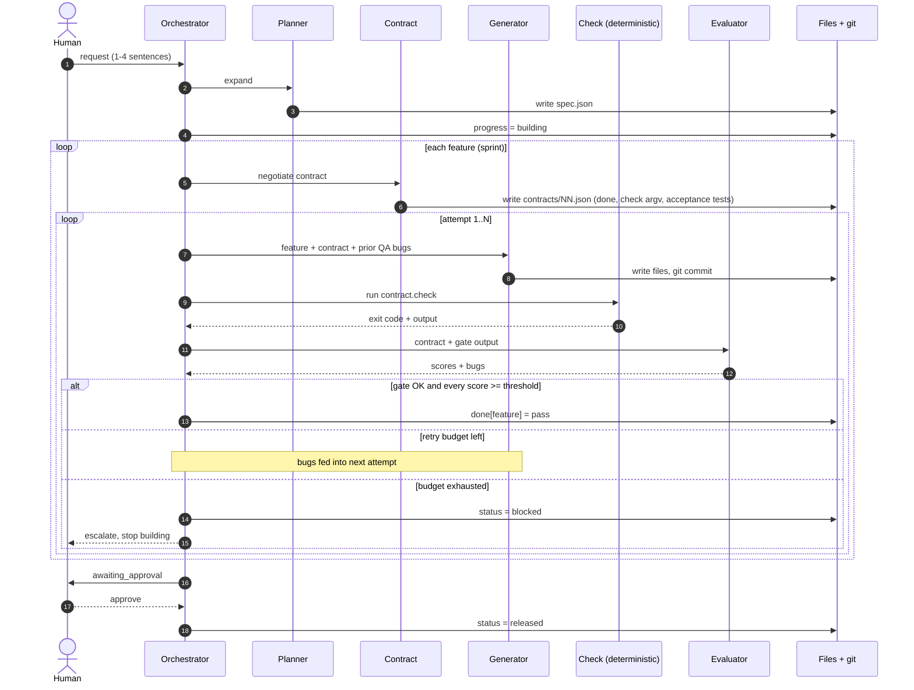
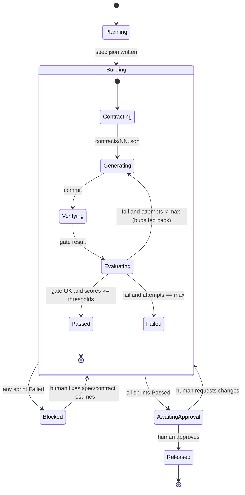
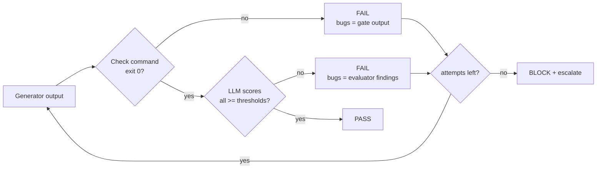
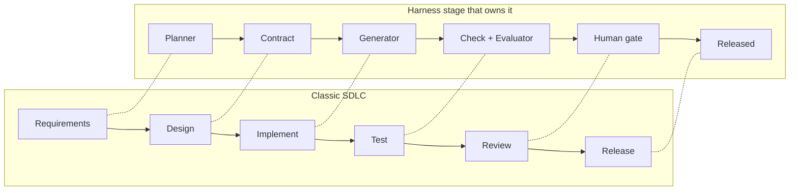
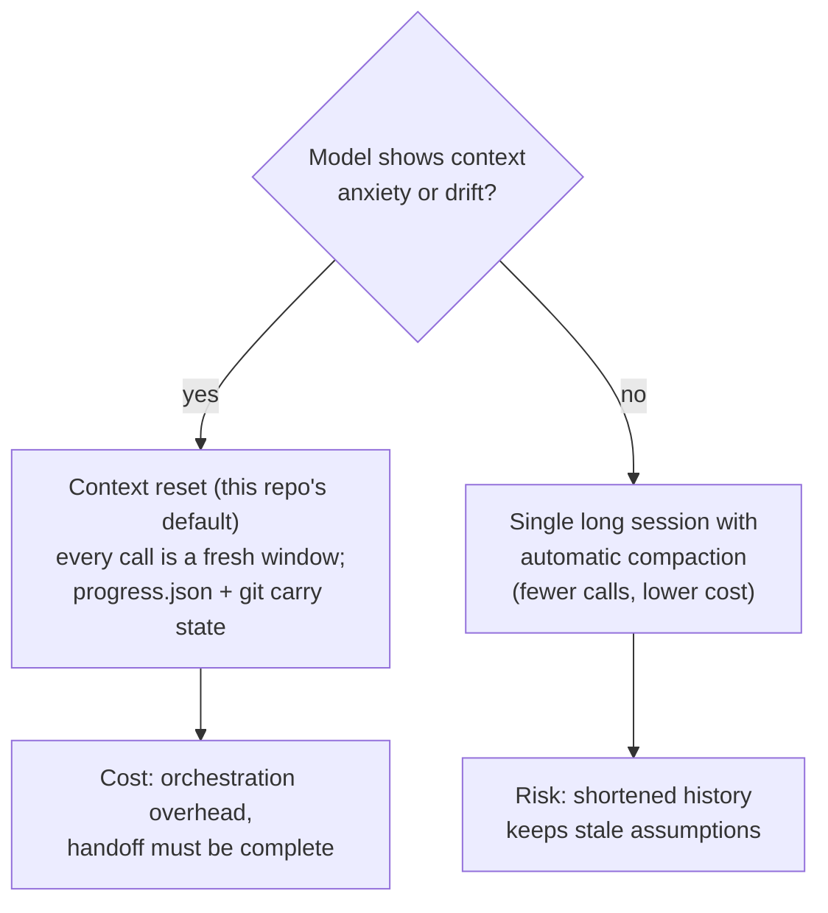
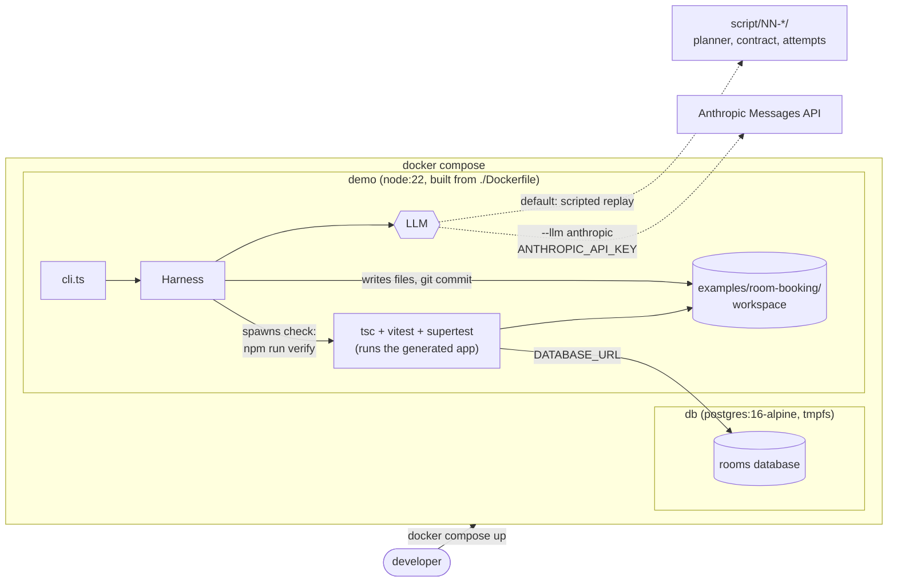
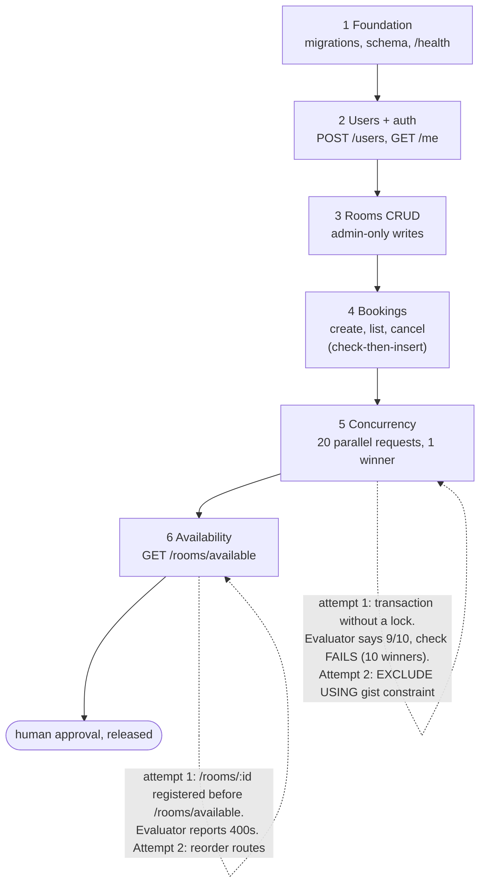
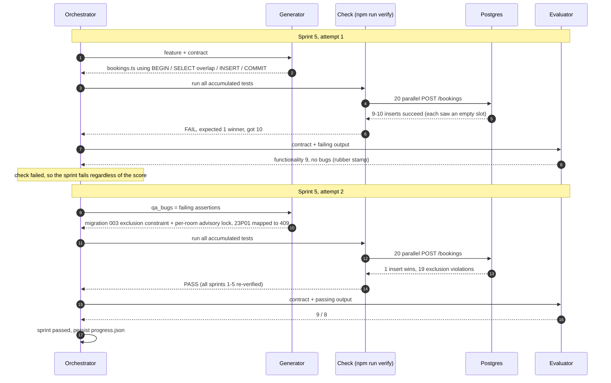

# Architecture

Design basis: Anthropic's [Harness design for long-running application development](https://www.anthropic.com/engineering/harness-design-long-running-apps).
Core idea: **the agent that builds is never the agent that judges**, agents share no context window,
and all state moves through files and git.

## 1. System architecture

## 2. End-to-end flow (sequence)

## 3. Sprint state machine

## 4. Pass/fail decision

The deterministic gate comes first and **cannot be overridden by the evaluator**: a 10/10 from the
LLM does not pass failing code (unit test: *a deterministic check overrides a lenient evaluator*; live demo: sprint 5, attempt 1).

## 5. Where this sits in the SDLC

## 6. Context strategy

## 7. Handoff artifacts

| File | Writer | Reader | Purpose |
|---|---|---|---|
| `.harness/spec.json` | Planner | Contract, Orchestrator | Ambitious scope, no implementation detail |
| `.harness/contracts/NN.json` | Contract negotiator | Generator, Check, Evaluator | Definition of done, runnable `check` argv, and the **acceptance tests**, which the harness restores before every check so the generator cannot weaken them |
| source tree + git | Generator | Check, Evaluator | Work product and rollback points |
| `.harness/progress.json` | Orchestrator | Orchestrator (next process) | Resume after crash or context reset |

## 8. Design assumptions to re-test as models improve

Each component encodes a belief that the model can't do something alone. Ablate one at a time.

| Component | Assumption | Test by |
|---|---|---|
| Planner | Model under-scopes from a short prompt | Skip it, compare feature count |
| Sprint contract | Model drifts from spec mid-build | Merge contract into generator prompt |
| Separate evaluator | Self-grading is lenient | Let generator self-score, compare escaped bugs |
| Per-sprint evaluation | Long builds need frequent QA | Evaluate once at the end |
| Context resets | Model gets anxious near the limit | Use compaction, compare completion |

## 9. Docker topology

Everything runs in containers; nothing needs to be installed on the host except Docker.

`db` has a healthcheck, `demo` waits for it, and the exit code of `demo` is the exit code of the run
(non-zero when a sprint is blocked).

## 10. The room-booking run, sprint by sprint

Six sprints, 47 acceptance tests, two deliberate failures that the harness must catch and repair.

Why this example works for the demo:

- **Real Postgres is the verifier.** The invariant (no overlapping confirmed bookings) is enforced by a
  GiST exclusion constraint (plus a per-room advisory lock that queues writers), and the check proves it with real concurrent transactions. A mock cannot.
- **Regression safety is automatic.** The check is cumulative, so sprint 6 re-runs the tests of sprints 1 to 5.
- **The generator cannot cheat.** Acceptance tests are owned by the contract and restored before each check.
